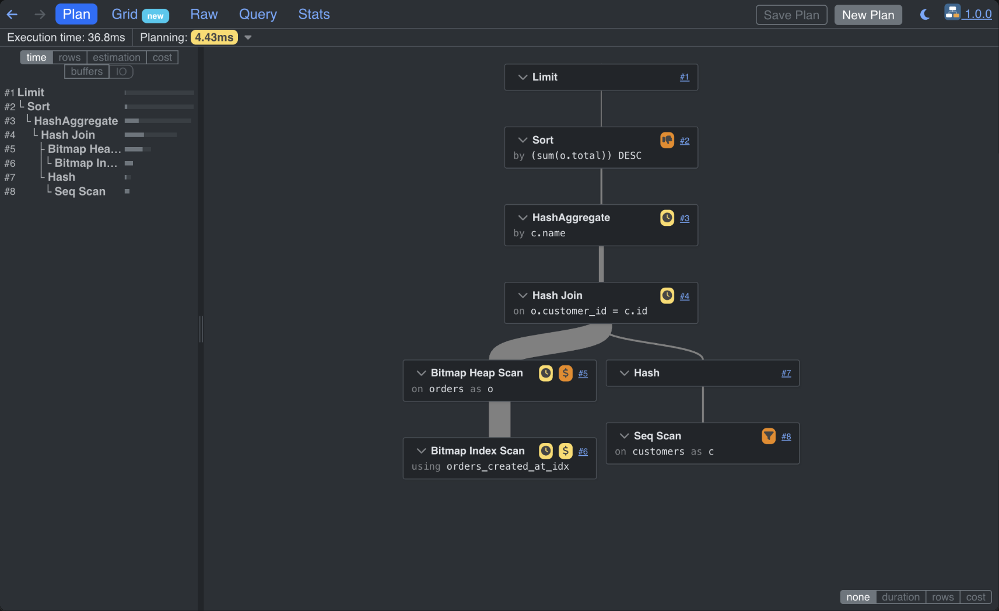

# Postgres Explain Visualizer

**Author:** Mujeeb · **Version:** 1.0.0

Shows the output of PostgreSQL's `EXPLAIN` as an interactive diagram in a VS Code tab: which node feeds which, how many rows flow between them, and where the time, the cost and the buffers went. The plan is read and drawn on your machine. Nothing is sent anywhere.



## How to use it

Run your query with `EXPLAIN (ANALYZE, BUFFERS)`. Plain `EXPLAIN` works too; there is less to show. Then use one of these:

- **Postgres: Visualize EXPLAIN Plan** (Command Palette). It draws the selection in the editor, or the whole editor if it holds a plan, or else the plan on the clipboard.
- In VS Code's terminal, select the output in psql, right-click and choose **Visualize EXPLAIN Plan**.
- In an editor, select the output, right-click and choose **Visualize EXPLAIN Plan**.
- **Postgres: Open Explain Visualizer** (Command Palette) opens the visualizer's home page, with no plan needed: paste one there, or try a sample plan.

The plan opens in a tab of its own, beside the editor it came from. Each time you run a command another tab opens, so you can keep several plans open and compare them. The title of a tab is the name you gave the plan, or else its top node and, for `EXPLAIN ANALYZE`, the execution time.

## The home page

- Paste the plan into **Plan** and press **Submit**. The statement can go into **Query**; if you paste a piece of a psql session, the statement above the plan is found for you. **Plan Name** and **Comments** are optional; the comments get a tab of their own beside the plan.
- **Sample Plans** fills the form with one of fourteen plans to try: joins, CTEs, parallel workers, partitions, triggers, a very large plan.
- Nothing you submit is saved. To keep a plan, press **Save Plan** beside it. From then on the home page has a **Saved Plans** list. Click a plan to draw it again. The pencil puts it into the form to edit: change its name, plan, query or comments and press **Save Changes** (or **Cancel**). The bin deletes it, after asking.
- The arrows at the top left go **Back** and **Forward** between the home page and the plans drawn from it, as in a browser. **New Plan**, beside a plan, is the home page with an empty form. **Save Plan** is there for every plan, however it was opened. A tab opened by one of the other commands has the home page behind it too, with the plan in the form to change and submit again.

## What you can give it

- The text format (the default) and the JSON format (`EXPLAIN (FORMAT JSON)`).
- Output copied straight from psql. The `QUERY PLAN` header, the row count, the borders of `\pset border` and the `+` at the end of wrapped lines are fine.
- A piece of a psql session. If the `EXPLAIN` statement is above the plan, it is shown on the Query tab, without psql's prompts. What follows the plan (`Time:`, the next prompt) is ignored.
- A plan that `auto_explain` wrote to the server log.

## In the tab

- **Plan**: the diagram. Click a node's name to open its details: timing, rows, cost, buffers, output and workers. The outline on the left lists the nodes with a bar for their time, rows, estimation, cost or buffers; click a line to go to its node. The buttons at the bottom right add a bar to every node for its duration, rows or cost. Scroll to zoom, drag to move.
- **Grid**: the same nodes as a table.
- **Raw**: the plan as it was given, with a button to copy it.
- **Query**: the statement, when it came with the plan.
- **Stats**: time and counts per table, per function, per node type and per index.
- The moon at the top right switches between the dark and the light look. It starts dark. Your choice applies to every open tab and is remembered.

## What it can't read

- The XML and YAML formats.
- A text plan made with `COSTS OFF` and without `ANALYZE`: its lines have only the node names to go by. The JSON format works with any options.

## Privacy

The extension makes no network requests, and the tab that shows the plan is not allowed to make any: its content security policy blocks all loading from the network and runs only the extension's own script. Text in a plan, such as table names and the values in filters, is shown as text and never as HTML. The links in the tab (this repository, the PostgreSQL manual) open in your browser when you click them.

No plan is saved unless you press **Save Plan** beside it. The plans you save that way are kept on your computer, in a file (`plans.json`) in VS Code's storage folder for this extension, until you delete them on the home page.

## Tests

- `npm run test:unit` runs the tests of the extension's own code (finding the plan and the statement in real psql output, the list of saved plans, the sample plans) and the visualizer's tests of its plan parser.
- `npm run test:integration` runs the commands in a separate VS Code window and checks what the tab shows: the diagram, every tab and button, several plans at once, the dark and light look, the home page with its form, sample plans, saved plans and Back and Forward, and that HTML in a plan stays text. It uses the VS Code in `/Applications`; set `VSCODE_EXECUTABLE` for another one.

## How it is built

| Folder | What is in it |
| --- | --- |
| `src/extension.ts`, `src/planText.ts`, `src/savedPlans.ts` | The extension: the commands, finding the plan in the text, the tab, the saved plans. |
| `src/webview/` | The page inside the tab: the home page, the tab's history, the dark/light button, and the visualizer it loads. `samples.ts` is the sample plans of pev2's example app, unchanged. |
| `src/pev2/` | The visualizer (Vue 3 and TypeScript): a copy of pev2 1.25.0 with the changes listed below. |
| `src/test/` | Unit tests, integration tests and the psql output they use. |

`npm run compile` type-checks everything and builds two bundles with Vite: `out/extension.js` and `out/webview/`. Every dependency is bundled, so they are all dev dependencies and the extension is packaged with `--no-dependencies`.

Changes to pev2's source, to make again when taking a newer version of it:

- `components/LogoImage.vue`: this extension's logo.
- `components/Plan.vue`: the links point to this repository; two slots, `navigation` before the tabs (Back and Forward) and `toolbar` beside the logo (New Plan, dark/light); a plan that can't be parsed is shown as text, not as HTML.
- `filters.ts`: where to report a bug.
- `services/__tests__/from-text/47-planned-partitions-plan`: a comment line removed.

## Release

Bump `version` in package.json, add the changes to CHANGELOG.md, commit, then push a matching tag. The Publish workflow runs the unit tests and publishes to the Marketplace.

```
git tag v1.0.1
git push origin v1.0.1
```

## License

MIT for the extension. The visualizer in `src/pev2` is under the PostgreSQL License, and the npm packages built into the extension are under their own licenses. The texts are in the LICENSE file and, in the packaged extension, in the `THIRD-PARTY-NOTICES.txt` files.
